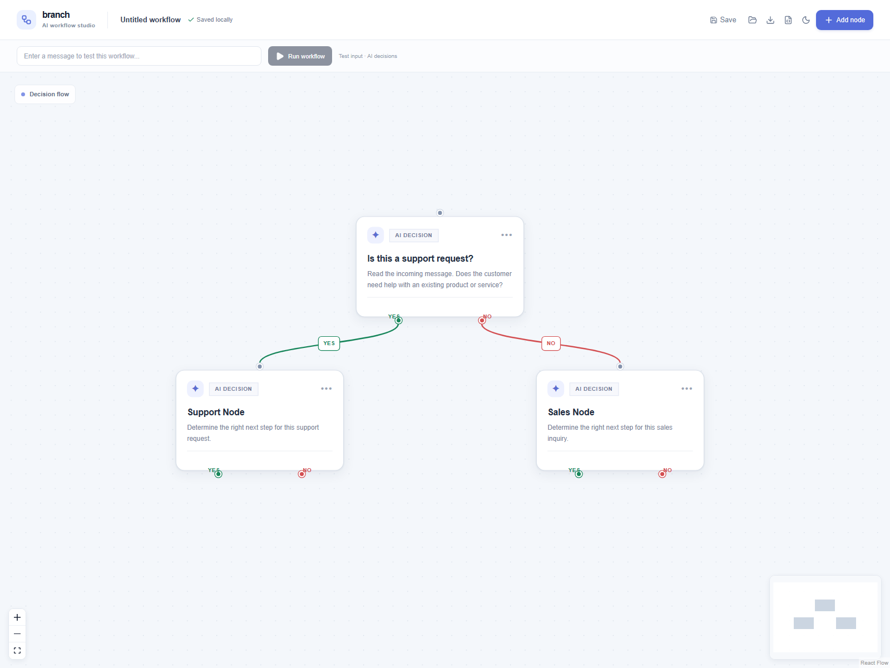
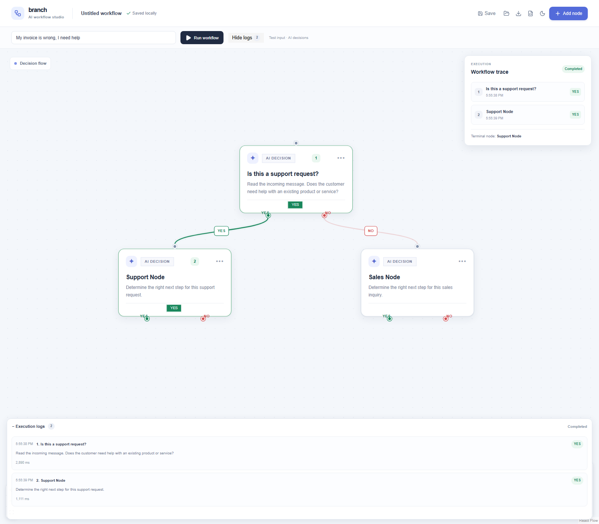

# Branch — AI workflow editor

A visual editor and Inngest-backed runner for AI decision workflows. Each
decision node returns YES or NO and follows the matching branch.

## Features

- Visual React Flow canvas with editable, draggable AI decision nodes.
- Durable Inngest step per decision and OpenAI `gpt-4o-mini` YES/NO decisions.
- Live node statuses, branch highlighting, execution logs, and failed-node retry.
- Save/load named workflows, JSON import/export, and recent-run replay.
- Light/dark mode and local browser persistence.

## Screenshots

### Workflow editor



### Completed AI execution



## Requirements

- Node.js 18.17 or newer
- npm
- An OpenAI API key to run AI decisions

## Setup

Install dependencies:

```powershell
npm install
```

Copy `.env.example` to `.env.local` and set `OPENAI_API_KEY`:

```powershell
Copy-Item .env.example .env.local
```

| Variable | Purpose |
| --- | --- |
| `OPENAI_API_KEY` | Required for AI node decisions (uses `gpt-4o-mini`) |
| `INNGEST_EVENT_KEY` | Inngest Cloud event publishing; leave blank for local dev |
| `INNGEST_SIGNING_KEY` | Inngest Cloud request verification; leave blank for local dev |
| `INNGEST_DEV` | Set to `1` for the local Inngest dev server |

`.env.local` is gitignored. Never commit API keys.

## Run both servers

Start Next.js in one terminal:

```powershell
npm run dev
```

Start Inngest in another:

```powershell
npm run inngest
```

Open [http://localhost:3000](http://localhost:3000). The Inngest dev dashboard
is usually at [http://localhost:8288](http://localhost:8288). The `/api/inngest`
endpoint serves the `hello` and `runWorkflow` functions for discovery.

## Test a workflow

Enter a message in the test-input field and click **Run workflow**. The browser
POSTs the current graph and input to `/api/run`, then polls `/api/runs/{runId}`.
The canvas marks each node as idle, running, completed, or failed; the executed
answer and step number appear on each node. Taken and active branches are
highlighted, while unselected branches are dimmed. Open **Execution logs** for
timestamps, prompts, decisions, durations, and errors.

With the seeded graph, try these separately:

1. `My invoice is wrong, I need help` — the expected first decision is YES and
   the path continues to **Support Node**.
2. `I want to learn about pricing for a new subscription` — the expected first
   decision is NO and the path continues to **Sales Node**.

Each visited node is a separate durable `step.run` in Inngest. Decisions are
trimmed and normalized, retried once with a stricter YES/NO instruction if the
response is invalid, and fail the run if still invalid. Traversal stops at a
terminal branch and guards against cycles and paths longer than 25 nodes.
Transient Inngest step errors have two retries. After a terminal failure, use
**Retry failed node** to start a new Inngest run from that node while carrying
forward completed trace entries.

Use **Save** or open the workflow library to save by name. The library lets you
load/delete saved graphs and replay one of the latest 20 runs. **Export JSON**
downloads the current graph. **Import JSON** validates node IDs, edge endpoints,
YES/NO handles, and duplicate outgoing branches with zod before replacing it.
Use the sun/moon button to switch themes.

## Run-state storage limitation

Run status and traces are held in a process-level in-memory map so local
development can update and poll runs without another database. This is
ephemeral: restarts clear runs, and multi-instance/serverless deployments may
route API and Inngest requests to different processes. Use shared durable
storage (for example Redis or a database) before deploying that topology.

Named workflows, the current graph, theme selection, and the last 20 run
snapshots are stored in browser local storage. They are per-browser and do not
sync across devices. The OpenAI key must be configured in the Next.js server
environment; no AI call is made when the key is missing.
